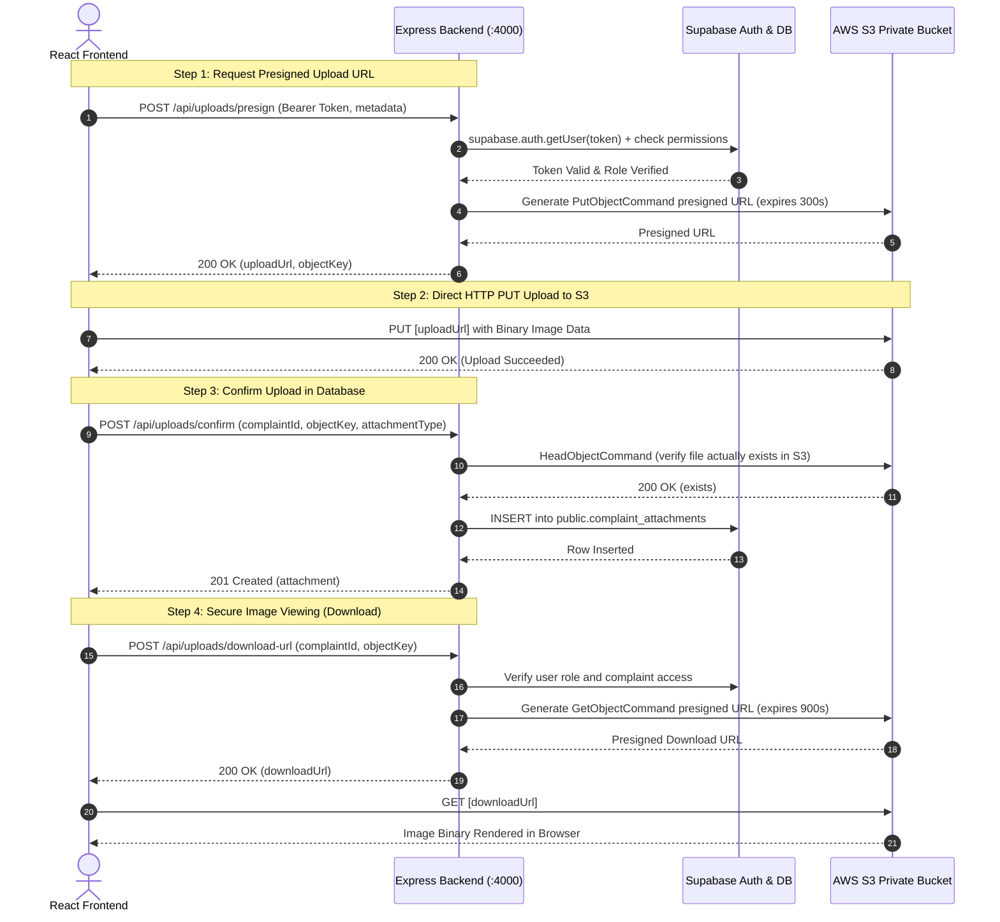

# Mysuru Civic Connect (MCC) — Cloud Backend Service

Node.js and Express backend service powering **AWS S3 Presigned URL generation**, **Supabase Auth token verification**, and **secure complaint image workflows**.

---

## 1. Backend Architecture



---

## 2. Directory Structure

```
backend/
├── src/
│   ├── server.js               # Express application entrypoint & CORS
│   ├── config/
│   │   ├── aws.js              # AWS SDK v3 S3 client configuration
│   │   └── supabase.js         # Supabase client & connection helpers
│   ├── middleware/
│   │   └── authMiddleware.js   # Supabase JWT token verification
│   ├── routes/
│   │   └── uploadRoutes.js     # Presign, Confirm, and Download endpoints
│   ├── services/
│   │   └── s3Service.js        # S3 presigning and HeadObject checks
│   └── utils/
│       └── fileValidation.js   # File type, 5MB limit & object key formatting
├── test/
│   ├── fileValidation.test.js  # Unit tests for validation & key scoping
│   └── endpoints.test.js       # Integration tests for route security
├── .env.example                # Template for environment configuration
├── package.json
└── README.md
```

---

## 3. API Endpoints Reference

### 3.1 `GET /api/health`
Health check verifying backend status and cloud connectivity.
- **Auth:** Public
- **Response `200 OK`:**
```json
{
  "status": "ok",
  "service": "Mysuru Civic Connect (MCC) Cloud Backend",
  "version": "1.0.0",
  "timestamp": "2026-11-14T14:30:00.000Z",
  "cloudIntegrations": {
    "awsS3": { "configured": true, "bucket": "mcc-complaint-images-demo", "region": "ap-south-1" },
    "supabase": { "configured": true, "url": "https://xyz.supab..." }
  }
}
```

---

### 3.2 `POST /api/uploads/presign`
Generates a short-lived presigned PUT URL allowing the frontend to upload directly to S3.
- **Auth:** `Bearer <Supabase_JWT_Token>`
- **Request Body:**
```json
{
  "complaintId": "3fa85f64-5717-4562-b3fc-2c963f66afa6",
  "fileName": "pothole_crossroad.jpg",
  "contentType": "image/jpeg",
  "fileSize": 1048576,
  "attachmentType": "issue"
}
```
- **Validation Rules:**
  - `attachmentType`: strictly `'issue'` or `'resolution'`.
  - `contentType`: `image/jpeg`, `image/jpg`, `image/png`, or `image/webp`.
  - `fileSize`: maximum 5 MB (5,242,880 bytes).
  - Role permissions: Citizens can only upload `'issue'` to their own complaint; Field Officers can only upload `'resolution'` to complaints assigned to their department/account.
- **Response `200 OK`:**
```json
{
  "success": true,
  "message": "Presigned upload URL generated successfully.",
  "uploadUrl": "https://mcc-complaint-images-demo.s3.ap-south-1.amazonaws.com/complaints/3fa85f64.../1731578990-a1b2c3d4.jpg?X-Amz-Algorithm=...",
  "objectKey": "complaints/3fa85f64-5717-4562-b3fc-2c963f66afa6/1731578990-a1b2c3d4.jpg",
  "bucket": "mcc-complaint-images-demo",
  "expiresInSeconds": 300
}
```

---

### 3.3 `POST /api/uploads/confirm`
Verifies that the object actually exists in S3 (via `HeadObjectCommand`) and saves the attachment metadata into Supabase PostgreSQL table `complaint_attachments`.
- **Auth:** `Bearer <Supabase_JWT_Token>`
- **Request Body:**
```json
{
  "complaintId": "3fa85f64-5717-4562-b3fc-2c963f66afa6",
  "objectKey": "complaints/3fa85f64-5717-4562-b3fc-2c963f66afa6/1731578990-a1b2c3d4.jpg",
  "attachmentType": "issue",
  "fileName": "pothole_crossroad.jpg",
  "fileSize": 1048576
}
```
- **Security Check:** Strictly validates that `objectKey` begins with `complaints/<complaintId>/` or `resolutions/<complaintId>/` to prevent cross-complaint injection.
- **Response `201 Created`:**
```json
{
  "success": true,
  "message": "Attachment verified and recorded successfully.",
  "attachment": {
    "id": "7c9e6679-7425-40de-944b-e07fc1f90ae7",
    "complaint_id": "3fa85f64-5717-4562-b3fc-2c963f66afa6",
    "uploaded_by": "8f88bb80-e817-4228-9896-e26090c2394d",
    "s3_object_key": "complaints/3fa85f64-5717-4562-b3fc-2c963f66afa6/1731578990-a1b2c3d4.jpg",
    "attachment_type": "issue",
    "file_name": "pothole_crossroad.jpg",
    "file_size_bytes": 1048576,
    "created_at": "2026-11-14T14:32:00.000Z"
  }
}
```

---

### 3.4 `POST /api/uploads/download-url`
Authorizes access to a private image and returns a short-lived presigned GET URL (15 minutes).
- **Auth:** `Bearer <Supabase_JWT_Token>`
- **Request Body:**
```json
{
  "complaintId": "3fa85f64-5717-4562-b3fc-2c963f66afa6",
  "objectKey": "complaints/3fa85f64-5717-4562-b3fc-2c963f66afa6/1731578990-a1b2c3d4.jpg"
}
```
- **Access Control:**
  - Citizen: allowed if `complaint.citizen_id === auth.uid()`.
  - Officer: allowed if assigned to complaint or department matches.
  - Corporator: allowed if complaint is inside corporator's designated ward.
  - Admin: allowed city-wide.
- **Response `200 OK`:**
```json
{
  "success": true,
  "downloadUrl": "https://mcc-complaint-images-demo.s3.ap-south-1.amazonaws.com/complaints/3fa85f64.../1731578990-a1b2c3d4.jpg?X-Amz-Algorithm=...",
  "objectKey": "complaints/3fa85f64-5717-4562-b3fc-2c963f66afa6/1731578990-a1b2c3d4.jpg",
  "expiresInSeconds": 900
}
```

---

## 4. AWS S3 Bucket Setup & CORS Configuration

### 4.1 Create S3 Bucket in AWS Console
1. Log in to [AWS Management Console](https://console.aws.amazon.com/s3/).
2. Click **Create bucket**.
3. **Bucket name:** `mcc-complaint-images-demo` (must be globally unique).
4. **AWS Region:** `ap-south-1 (Asia Pacific - Mumbai)`.
5. **Block Public Access settings for this bucket:** Keep **Block *all* public access** checked (**ON**).
   > *Security note:* Complaint and resolution photos are private records and must never be public. Presigned URLs grant temporary, authorized read access.
6. Click **Create bucket**.

### 4.2 Configure S3 CORS Policy
In your S3 bucket page:
1. Click the **Permissions** tab.
2. Scroll down to **Cross-origin resource sharing (CORS)** and click **Edit**.
3. Paste the following JSON:
```json
[
  {
    "AllowedHeaders": [
      "*"
    ],
    "AllowedMethods": [
      "PUT",
      "GET",
      "HEAD"
    ],
    "AllowedOrigins": [
      "http://localhost:3000",
      "http://localhost:5173",
      "https://*.cloudfront.net"
    ],
    "ExposeHeaders": [
      "ETag"
    ],
    "MaxAgeSeconds": 3000
  }
]
```
4. Click **Save changes**.

---

## 5. IAM User & Credentials
Create an IAM User in AWS with programmatic access and attach this policy:
```json
{
  "Version": "2012-10-17",
  "Statement": [
    {
      "Effect": "Allow",
      "Action": [
        "s3:PutObject",
        "s3:GetObject",
        "s3:HeadObject"
      ],
      "Resource": "arn:aws:s3:::mcc-complaint-images-demo/*"
    }
  ]
}
```

---

## 6. How to Run the Backend Locally

```bash
# 1. Navigate to backend directory
cd backend

# 2. Configure environment
cp .env.example .env
# Edit .env with your SUPABASE_URL, SUPABASE_PUBLISHABLE_KEY, and AWS credentials

# 3. Start development server
npm run dev
# Server starts on http://localhost:4000
```

